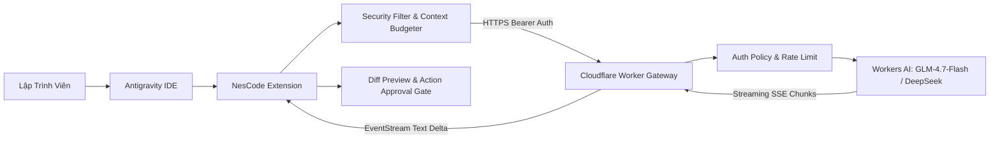

# NesCode for Antigravity — Trợ Lý Lập Trình AI Trên Nền Tảng Cloudflare Free Tier

[](package.json)
[-success.svg)](tests/)
[](https://developers.cloudflare.com/workers-ai/)
[-blue.svg)](src/worker/wrangler.jsonc)
[](LICENSE)
[](tsconfig.base.json)

---

## 1. Giới Thiệu Dự Án (Project Overview)

**NesCode for Antigravity** là tiện ích mở rộng (extension) trợ lý lập trình trí tuệ nhân tạo (AI Coding Assistant) mã nguồn mở dành riêng cho **Antigravity IDE** (và các IDE tương thích chuẩn VS Code API), hoạt động theo mô hình **Bring Your Own Cloudflare Worker (BYO Worker)**.

Sản phẩm kết hợp sức mạnh suy luận của mô hình ngôn ngữ lớn trên nền tảng **Cloudflare Workers AI** (với mô hình mặc định `@cf/zai-org/glm-4.7-flash`) cùng kiến trúc serverless edge siêu nhẹ, giúp bạn sở hữu một trợ lý lập trình thông minh, bảo mật tuyệt đối và **hoàn toàn miễn phí trên gói Cloudflare Free Tier** (100.000 requests/ngày và 10.000 Neurons AI/ngày), không phụ thuộc vào máy chủ trung gian hay đăng ký dịch vụ trả phí định kỳ.

---

## 2. Tính Năng Nổi Bật (Key Features)

### 🤖 Trợ Lý Lập Trình Thông Minh (Agentic Assistant & Action Cards)
- **Đề xuất tạo và sửa file (`write_file`):** AI tự động xuất ra khối hành động trực quan cho phép tạo file mới hoặc cập nhật file hiện tại.
- **Thực thi lệnh terminal (`run_command`):** AI đề xuất lệnh terminal (chạy test, cài gói thư viện) và chờ người dùng bấm chấp thuận để thực thi trực tiếp trên Integrated Terminal của IDE.
- **Hiển thị suy nghĩ (Thought Process):** Tự động bóc tách khối `<think>...</think>` thành hộp chi tiết mở rộng `💭 Quá trình suy nghĩ của AI`, giúp người dùng theo dõi mạch tư duy của mô hình.

### 🔍 So Sánh Thay Đổi Trực Quan (Visual Diff Preview)
- **Xem trước khác biệt (Diff Editor):** Mỗi đề xuất sửa file đi kèm nút **[🔍 Xem So Sánh (Diff)]**, mở trực tiếp giao diện `vscode.diff` so sánh trực quan xanh/đỏ giữa phiên bản hiện tại và đề xuất mới.
- **Bảo vệ tài liệu sửa đổi ngầm (Stale Document Protection):** Tự động phát hiện nếu file đang có thay đổi chưa lưu (dirty) và cảnh báo người dùng xác nhận trước khi áp dụng để chống mất mát dữ liệu ngoài ý muốn.

### 🛡️ Bảo Mật Tuyệt Đối & Lọc File Nhạy Cảm (Security & Privacy First)
- **Lưu trữ bí mật an toàn:** Khóa xác thực backend (`NESCODE_API_KEY`) được mã hóa và lưu trữ độc quyền trong `SecretStorage` do Antigravity IDE cung cấp, không lưu vào `settings.json` hay file cấu hình.
- **Bộ lọc bảo vệ file nhạy cảm:** Tự động loại trừ các file bí mật (`.env`, `*.pem`, `*.key`, `*credentials*`, `*secret*`) và thư mục phụ thuộc lớn (`node_modules/`, `.git/`, `dist/`, `.venv/`).
- **Chống Path Traversal:** Chuẩn hóa đường dẫn nghiêm ngặt, từ chối mọi thao tác ghi đè hoặc đọc lùi ra ngoài thư mục dự án (`../`).

### 📂 Ngữ Cảnh Dự Án Tự Động (Smart Workspace Context)
- **Tự nhận diện thư mục dự án cha:** Tự động dò tìm thư mục gốc chứa `.git` hoặc `package.json` ngay cả khi bạn mở một file đơn lẻ trong thư mục con.
- **Đọc ngữ cảnh thông minh:** Tự động tổng hợp cây thư mục rút gọn và nạp nội dung các tài liệu cốt lõi (`README.md`, `TASK_BOARD.md`, `package.json`, tệp đang mở) với dung lượng tinh gọn (~8k-10k ký tự), giúp AI nắm bắt tiến độ dự án chỉ sau 1-2 giây phản hồi.
- **Chip ngữ cảnh trực quan:** Hiển thị thẻ tệp đang mở với nút đóng `[✕]` cho phép bật/tắt đính kèm ngữ cảnh chỉ bằng một cú nhấp chuột.

### 🖱️ Menu Ngữ Cảnh Soạn Thảo (Editor Context Menu Actions)
Bôi đen bất kỳ đoạn mã nào trong trình soạn thảo, nhấp chuột phải để gọi nhanh:
- **Giải Thích Mã Nguồn (Explain Code):** Phân tích luồng thuật toán, kiến trúc và bắt lỗi tiềm ẩn.
- **Tìm & Sửa Lỗi (Fix Code):** Phân tích lỗi cú pháp, ngoại lệ runtime và tự động xuất ra Action Card sửa file.
- **Viết Kiểm Thử Tự Động (Generate Tests):** Tự động sinh mã unit test toàn diện cho đoạn code đã chọn.

### 💬 Đa Phiên Làm Việc & Lưu Trữ Bền Vững (Multi-Session & Persistent State)
- Hỗ trợ tạo không giới hạn phiên chat độc lập, chuyển đổi nhanh qua ngăn kéo Lịch Sử (History Drawer).
- Tự động lưu bản nháp đang gõ (`draftPrompt`), trạng thái checkbox và nội dung hội thoại, không bao giờ mất dữ liệu khi đóng/mở sidebar.

---

## 3. Kiến Trúc Hệ Thống (Architecture)



- **Extension Layer (`src/extension/`):** Chạy trên Extension Host của Antigravity, giao tiếp qua VS Code Extension API công khai, quản lý Webview chat, Action Cards, Diff Editor và Context Engine.
- **Worker Gateway (`src/worker/`):** Serverless edge gateway phi trạng thái (stateless) kết nối Cloudflare Workers AI (`env.AI`).
- **Shared Layer (`src/shared/`):** Định nghĩa hợp đồng dữ liệu, hằng số cấu hình và bộ lọc bảo mật dùng chung thuần khiết.

---

## 4. Hướng Dẫn Cài Đặt & Sử Dụng (Quick Start)

### Bước 1: Cài Đặt Tiện Ích Mở Rộng Vào Antigravity IDE

Tải file gói cài đặt **`build/nescode-antigravity-0.1.0.vsix`** từ thư mục `build/` của dự án:
1. Mở Antigravity IDE.
2. Bấm vào biểu tượng **Extensions** ở thanh bên (hoặc phím tắt `Ctrl+Shift+X`).
3. Bấm vào menu ba chấm `...` ở góc trên bên phải của bảng Extensions, chọn **Install from VSIX...**.
4. Chọn tệp `nescode-antigravity-0.1.0.vsix`.

*(Hoặc cài đặt nhanh qua dòng lệnh terminal:)*
```bash
antigravity --install-extension build/nescode-antigravity-0.1.0.vsix
```

---

### Bước 2: Tự Triển Khai Backend Cloudflare Worker (BYO Worker)

*(Thời gian thực hiện: ~2 phút, hoàn toàn miễn phí trên Cloudflare Free Tier)*

1. Đăng nhập tài khoản Cloudflare qua terminal:
   ```bash
   npx wrangler login
   ```
2. Thiết lập khóa bí mật xác thực (Worker Secret):
   ```bash
   cd src/worker
   npx wrangler secret put NESCODE_API_KEY
   ```
   *Nhập chuỗi mật mã an toàn của bạn (ví dụ: `my-super-secret-key-12345678`)*.
3. Triển khai backend lên Cloudflare Edge:
   ```bash
   npx wrangler deploy
   ```
   Sau khi hoàn tất, terminal sẽ hiển thị địa chỉ Worker URL cá nhân của bạn:
   `https://nescode-ai-gateway.<subdomain>.workers.dev`

---

### Bước 3: Cấu Hình Kết Nối Trên IDE

1. Mở Antigravity IDE, nhấn tổ hợp phím **`Ctrl+Shift+P`**.
2. Tìm và chọn lệnh: **`NesCode: Cấu Hình Kết Nối Worker`**.
3. Nhập **Worker URL** vừa nhận được ở Bước 2.
4. Nhập **API Key** bạn đã thiết lập ở Bước 2 (Khóa được lưu bảo mật trong `SecretStorage`).
5. Bấm `Ctrl+Shift+P`, chọn **`NesCode: Kiểm Tra Kết Nối`** để kiểm tra trạng thái **Connected**.
6. Bấm vào biểu tượng NesCode AI trên thanh Activity Bar bên trái để bắt đầu lập trình cùng AI!

---

## 5. Danh Mục Lệnh & Phím Tắt (Commands)

| Tên Lệnh (Command) | Mã Lệnh (Command ID) | Mô Tả |
| :--- | :--- | :--- |
| **Mở Khung Chat AI** | `nescode.openChat` | Mở thanh bên trợ lý lập trình NesCode |
| **Cấu Hình Kết Nối Worker** | `nescode.configureConnection` | Nhập URL Worker và API Key cá nhân |
| **Kiểm Tra Kết Nối** | `nescode.checkConnection` | Ping kiểm tra kết nối tới Cloudflare Worker |
| **Giải Thích Mã Nguồn** | `nescode.explainCode` | Giải thích đoạn code đang chọn qua menu chuột phải |
| **Tìm & Sửa Lỗi Đoạn Mã** | `nescode.fixCode` | Phân tích lỗi và đề xuất bản vá qua Diff Editor |
| **Viết Kiểm Thử Tự Động** | `nescode.generateTests` | Tự động sinh mã unit test cho đoạn code chọn |

---

## 6. Phát Triển & Kiểm Thử Tự Động (Development & Testing)

Dự án sử dụng cơ chế kiểm thử tích hợp của Node.js (hỗ trợ TypeScript Native Strip Types), không đòi hỏi cài đặt các framework kiểm thử cồng kềnh:

```bash
# Cài đặt phụ thuộc cho toàn bộ monorepo
npm install

# Chạy toàn bộ 13 bài kiểm thử tự động toàn diện
npm test

# Biên dịch module dùng chung
npm run build:shared

# Đóng gói tiện ích mở rộng VSIX
npm run package:extension
```

### Kết Quả Kiểm Thử Thực Tế:
```text
✔ HTML Unescaping - Restores comparison and logic operators in Python/TypeScript code
✔ HTML Unescaping - Restores quotes and ampersands in strings and shell commands
✔ HTML Unescaping - Handles single quotes and edge cases safely
✔ Action Parser - Successfully extracts write_file actions
✔ Action Parser - Successfully extracts run_command actions
✔ Action Parser - Handles multiple mixed actions seamlessly
✔ Security Filter - Correctly blocks sensitive files and secret directories
✔ Path Traversal Protection - Rejects unsafe paths with parent traversal
✔ Path Traversal Protection - Sanitizes valid relative paths cleanly
✔ Shared Constants - Verify model and token bounds
✔ Error Codes - Verify standard error code definitions
✔ SseParser - Handles full SSE stream cycle
✔ SseParser - Handles fragmented chunks and CRLF endings
ℹ tests 13 | pass 13 | fail 0 (100% PASS)
```

---

## 7. Lộ Trình Phát Triển & Tiến Độ Hoàn Thành (Milestones)

- [x] **Milestone M0: Compatibility Spike** — Khảo sát và kiểm chứng tính tương thích trên Antigravity IDE (Hoàn thành).
- [x] **Milestone M1: Worker Gateway** — Xây dựng và triển khai Cloudflare Worker Gateway kết nối Workers AI (Hoàn thành).
- [x] **Milestone M2: Extension MVP** — Core Client, SecretStorage, SSE Streaming và cấu hình kết nối (Hoàn thành).
- [x] **Milestone M3: Rich Chat Webview** — Giao diện trò chuyện chuyên nghiệp, Agentic Action Cards, Đa phiên làm việc (Hoàn thành).
- [x] **Milestone M4: Smart Context** — Tự động nhận diện thư mục dự án, nạp tài liệu và tối ưu token (Hoàn thành).
- [x] **Milestone M5: Safe Code Assistance** — Menu ngữ cảnh chuột phải, Visual Diff Preview và Stale Document Protection (Hoàn thành).
- [x] **Milestone M6: Quality & Release v0.1.0** — Bộ kiểm thử tự động 100% PASS, hoàn thiện tài liệu xuất bản và đóng gói VSIX chính thức (Hoàn thành).

---

## 8. Giấy Phép & Đóng Góp (License & Contributing)

- Dự án được phát hành dưới giấy phép [MIT License](LICENSE).
- Mọi đóng góp, báo lỗi hoặc đề xuất tính năng xin vui lòng tham khảo [docs/CONTRIBUTING.md](docs/CONTRIBUTING.md) hoặc gửi Issue / Pull Request trên GitHub.
