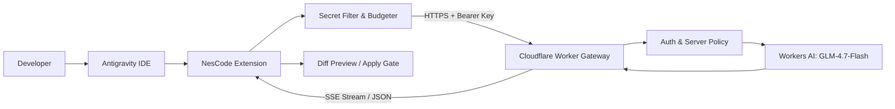

# NesCode for Antigravity — Trợ Lý Lập Trình AI Trên Nền Tảng Cloudflare Free Tier

[-orange.svg)](journal/planning/ROADMAP.md)
[](journal/milestones/M0_COMPATIBILITY_SPIKE.md)
[](LICENSE)
[](tsconfig.base.json)

> **Cảnh báo trạng thái thử nghiệm:** Dự án hiện đang trong giai đoạn khởi tạo kỹ thuật và thử nghiệm tính tương thích nền tảng (Milestone M0 — Compatibility Spike). Chưa có tính năng sản phẩm nào được phát hành chính thức.

---

## 1. Giới Thiệu Dự Án (Project Overview)

**NesCode for Antigravity** là tiện ích mở rộng (extension) trợ lý lập trình trí tuệ nhân tạo nguồn mở dành riêng cho **Antigravity IDE**, vận hành theo mô hình **Bring Your Own Cloudflare Worker (BYO Worker)**.

Sản phẩm kết hợp sức mạnh suy luận của mô hình ngôn ngữ lớn (LLM) trên nền tảng **Cloudflare Workers AI** (với mô hình mặc định `@cf/zai-org/glm-4.7-flash`) cùng kiến trúc serverless edge siêu nhẹ, giúp lập trình viên sở hữu một trợ lý AI mạnh mẽ, bảo mật cao và **hoàn toàn miễn phí trên gói Cloudflare Free Tier**, không đòi hỏi thuê máy chủ riêng hay trả phí API định kỳ.

---

## 2. Tính Năng Cốt Lõi Dự Kiến Cho Bản MVP (MVP Scope)

- **Trò Chuyện Trực Tiếp Trong IDE (AI Chat Panel):** Khung chat chuyên dụng tích hợp ở thanh bên của Antigravity IDE, hỗ trợ hiển thị Markdown, code block, streaming phản hồi thời gian thực và nút hủy (Stop).
- **Giải Thích Mã Nguồn (Explain Code):** Phân tích luồng thực thi, kiến trúc và cảnh báo lỗi tiềm ẩn từ đoạn code đang chọn hoặc file đang mở.
- **Sửa Mã Nguồn Trực Quan (Fix Code with Diff Preview):** AI đề xuất bản sửa dưới dạng unified diff trực quan; hỗ trợ hai nút thao tác độc lập: **Áp dụng (Apply)** hoặc **Từ chối (Reject)**, đi kèm cơ chế bảo vệ file không bị sửa đổi ngầm (Stale Document Protection).
- **Tạo Kiểm Thử Đơn Vị (Generate Tests):** Tự động sinh mã unit test đề xuất để người dùng xem trước, không tự ý chạy lệnh shell trong terminal.
- **Thu Thập Ngữ Cảnh An Toàn (Context Engineering):** Thu thập có kiểm soát từ selection, active file và file được chọn; tự động loại bỏ các file bí mật (`.env`, `*.key`) và kiểm soát ngân sách token (Context Budgeter 12k token mặc định) để không làm cạn kiệt quota Free.
- **Tự Triển Khai Backend Độc Lập (BYO Worker):** Mỗi người dùng tự deploy một Worker riêng trên tài khoản Cloudflare của mình qua Wrangler CLI; API key được lưu mã hóa an toàn trong `SecretStorage` của IDE.

---

## 3. Tóm Tắt Kiến Trúc Hệ Thống (Architecture Summary)



- **Mã nguồn phía Extension (`src/extension/`):** Chạy trên Extension Host của Antigravity, chỉ sử dụng public VS Code Extension API.
- **Mã nguồn phía Backend (`src/worker/`):** Serverless edge gateway phi trạng thái (stateless) kết nối Workers AI binding `env.AI`.
- **Hợp đồng dùng chung (`src/shared/`):** TypeScript interfaces, types và error codes thuần túy.

---

## 4. Cấu Trúc Kho Lưu Trữ (Repository Structure)

```text
nescode-antigravity/
├── AGENTS.md                  # Chỉ dẫn vận hành cốt lõi cho AI Agent
├── README.md                  # Tài liệu tổng quan dự án
├── LICENSE                    # Giấy phép MIT
├── package.json               # Cấu hình workspaces monorepo
├── tsconfig.base.json         # Cấu hình TypeScript Strict chuẩn
│
├── .agents/rules/             # Các quy tắc Antigravity Native Rules
│   ├── 00-core-governance.md  # Quy chuẩn quản trị bắt buộc
│   ├── 10-architecture.md     # Quy chuẩn kiến trúc & ranh giới
│   ├── 20-typescript.md       # Quy chuẩn lập trình TypeScript
│   ├── 30-security-privacy.md # An toàn & bảo vệ bí mật
│   ├── 40-testing-quality.md  # Chiến lược kiểm thử & chất lượng
│   └── 50-memory-journal.md   # Quản trị bộ nhớ & nhật ký
│
├── memory/                    # Tri thức bền vững đã tuyển chọn
│   ├── PROJECT_CONTEXT.md     # Bối cảnh & phạm vi sản phẩm
│   ├── ARCHITECTURE_CONTEXT.md# Bối cảnh kiến trúc đã xác minh
│   ├── TECH_STACK.md          # Ngăn xếp công nghệ
│   ├── ENGINEERING_CONSTRAINTS.md # Giới hạn Free tier & ngân sách
│   ├── CURRENT_STATE.md       # Trạng thái hiện tại của dự án
│   └── KNOWN_ISSUES.md        # Rủi ro & hạn chế kỹ thuật đã biết
│
├── journal/                   # Tiến trình phát triển có thể kiểm toán
│   ├── goals/                 # Tầm nhìn & mục tiêu MVP
│   ├── requirements/          # Bản gốc SRS.md & bảng ma trận truy vết
│   ├── planning/              # Lộ trình & các cột mốc M0 - M6
│   ├── tasks/                 # Task Board, Backlog & Completed Tasks
│   ├── decisions/             # Các bản ghi quyết định kiến trúc (ADR)
│   ├── milestones/            # Kế hoạch điều tra M0 Compatibility Spike
│   └── sessions/              # Nhật ký các phiên làm việc
│
├── src/                       # Ranh giới mã nguồn hệ thống
│   ├── extension/             # Tiện ích mở rộng Antigravity IDE
│   ├── worker/                # Backend Cloudflare Worker
│   └── shared/                # Kiểu dữ liệu & hằng số dùng chung
│
├── tests/                     # Hệ thống kiểm thử tự động
│   ├── unit/                  # Kiểm thử đơn vị
│   ├── integration/           # Kiểm thử tích hợp Miniflare
│   ├── compatibility/         # Kịch bản kiểm chứng tương thích M0
│   └── fixtures/              # Dữ liệu giả lập
│
├── env/                       # Mẫu cấu hình môi trường & bảo mật
└── docs/                      # Tài liệu kỹ thuật chi tiết
```

---

## 5. Yêu Cầu Tiên Quyết (Prerequisites)

- **Node.js:** Phiên bản `>= 20.x` (Đã kiểm chứng trên `v24.13.1`).
- **npm:** Phiên bản `>= 10.x` (Đã kiểm chứng trên `11.8.0`).
- **Antigravity IDE:** Môi trường IDE đích để cài đặt tiện ích mở rộng.
- **Tài khoản Cloudflare Free:** Dùng để tự triển khai Worker backend thông qua Wrangler CLI.

---

## 6. Trạng Thái Hiện Tại & Hành Động Kế Tiếp

- **Cột mốc hiện tại:** `M0 — Compatibility Spike`.
- **Hành động kế tiếp duy nhất:** Thực hiện `TASK-001` — Xây dựng một extension thử nghiệm tối thiểu, đóng gói `.vsix`, cài đặt vào Antigravity IDE để kiểm chứng tính tương thích của các API: `commands`, `WebviewView`, `SecretStorage`, và `Workspace API`.
- **Chính sách:** Chưa triển khai bất kỳ mã nguồn chức năng sản phẩm nào cho tới khi bài kiểm thử tương thích có kết luận **Go**.

---

## 7. Liên Kết Tài Liệu Quan Trọng (Important Links)

- [Đặc Tả Yêu Cầu Phần Mềm (SRS.md)](journal/requirements/SRS.md)
- [Ma Trận Truy Vết Yêu Cầu (Traceability)](journal/requirements/REQUIREMENT_TRACEABILITY.md)
- [Lộ Trình Phát Triển (Roadmap)](journal/planning/ROADMAP.md)
- [Kế Hoạch Kiểm Chứng M0 (Compatibility Spike)](journal/milestones/M0_COMPATIBILITY_SPIKE.md)
- [Tài Liệu Kiến Trúc (Architecture)](docs/ARCHITECTURE.md)
- [Hướng Dẫn Triển Khai BYO Worker (Deployment)](docs/DEPLOYMENT.md)
- [Chính Sách An Toàn & Bảo Mật (Security)](docs/SECURITY.md)
- [Hướng Dẫn Đóng Góp (Contributing)](docs/CONTRIBUTING.md)
