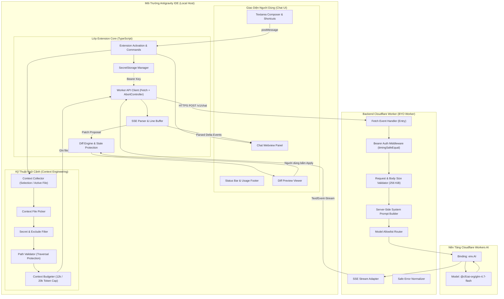

# Kiến Trúc Kỹ Thuật Hệ Thống (System Architecture)

- **Sản phẩm:** NesCode for Antigravity
- **Phiên bản kiến trúc:** 1.0.0 (Baseline MVP)
- **Tài liệu nguồn:** `journal/requirements/SRS.md` Phần 2, 7, 10

Tài liệu này trình bày chi tiết kiến trúc tổng thể, các luồng dữ liệu chính và ranh giới trách nhiệm của các thành phần trong NesCode for Antigravity.

---

## 1. Sơ Đồ Kiến Trúc Tổng Thể (Architecture Diagram)

---

## 2. Phân Tách Trách Nhiệm Chi Tiết

### 2.1. Phía Máy Cục Bộ (Extension Client)
- **Quyền riêng tư tuyệt đối:** Dữ liệu mã nguồn không bao giờ tự động rời máy người dùng khi chưa có thao tác chủ động.
- **Tiền xử lý an toàn (Pre-processing):** Toàn bộ file bí mật và file cấu hình bị loại trừ ngay tại máy cục bộ bằng `contextFilter`.
- **Cắt giảm ngữ cảnh (Budgeting):** Ước lượng token và giới hạn ngân sách ngữ cảnh (12k token mặc định) để bảo toàn hạn ngạch 10.000 Neurons/ngày của Cloudflare Free.
- **Diff Preview & Human Approval:** Mọi đề xuất thay đổi mã nguồn phải được render dưới dạng unified diff trực quan; chỉ khi người dùng bấm Apply, file mới được cập nhật sau khi kiểm tra tính toàn vẹn (Stale Document Protection).

### 2.2. Phía Cloudflare Worker Backend (BYO Worker)
- **Kiến trúc Serverless Edge:** Vận hành trên Cloudflare Workers với độ trễ tối thiểu toàn cầu, không tốn chi phí máy chủ.
- **Bảo mật bằng Bearer Key:** Mọi request bắt buộc phải có `Authorization: Bearer <NESCODE_API_KEY>` hợp lệ; từ chối mọi truy cập trái phép.
- **Không tin tưởng Client (Server-side Policy):** System Prompt được lưu trữ và xây dựng tại máy chủ; xem toàn bộ mã nguồn của người dùng là dữ liệu không tin cậy (untrusted context), ngăn ngừa triệt để kỹ thuật Prompt Injection.
- **Chuẩn hóa lỗi:** Mọi lỗi từ dịch vụ Workers AI được chuẩn hóa thành mã lỗi an toàn (`AI_QUOTA_EXCEEDED`, `AI_CAPACITY_UNAVAILABLE`) và không bao giờ rò rỉ stack trace.

---

## 3. Trạng Thái Hiện Thực Hóa (Implementation Status)

- **Đã thiết lập (Established):** Cấu trúc phân rã ranh giới module, các interface giao tiếp, quy chuẩn an toàn và sơ đồ logic.
- **Đang chờ kiểm chứng (Pending M0):** Khả năng tương thích thực tế của Extension Host trong Antigravity IDE (`WebviewView`, `SecretStorage`).
- **Kế hoạch triển khai (Planned):** Mã nguồn các module sẽ được lập trình trong các Milestone M1 đến M5.
