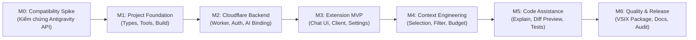

# Lộ Trình Phát Triển Dự Án (Development Roadmap)

- **Ngày cập nhật:** 2026-11-11
- **Cột mốc hiện tại:** `M0 — Compatibility Spike`
- **Nguồn thông tin:** `journal/requirements/SRS.md` Phần 14

Lộ trình phát triển của NesCode for Antigravity được chia thành 7 cột mốc tuần tự (từ M0 đến M6). Cột mốc M0 có mức ưu tiên tuyệt đối trước mọi công việc lập trình tính năng.

---

---

## Tóm Tắt Các Giai Đoạn (Milestone Overview)

### M0: Compatibility Spike (Kiểm Chứng Tương Thích Nền Tảng) — HIỆN TẠI
- **Mục tiêu:** Giảm thiểu rủi ro kiến trúc lớn nhất bằng cách tạo một extension tối thiểu, đóng gói VSIX và cài vào Antigravity IDE thực tế để kiểm chứng khả năng hỗ trợ API.
- **Phạm vi:** Kiểm tra `activate`, `commands`, `WebviewView`, `SecretStorage`, và `Workspace API`.
- **Đầu ra:** Báo cáo tương thích `docs/COMPATIBILITY.md` và quyết định Go/No-Go.

### M1: Nền Tảng Dự Án (Project Foundation)
- **Mục tiêu:** Xây dựng khung TypeScript monorepo, định nghĩa toàn bộ types dùng chung và cấu hình công cụ build.
- **Phạm vi:** `src/shared/` types/constants, cấu hình `esbuild`, cấu hình `tsconfig`, thiết lập test runner `Vitest`.
- **Đầu ra:** Các lệnh `npm run typecheck` và `npm test` chạy thành công.

### M2: Backend Cloudflare Worker (Cloudflare Backend MVP)
- **Mục tiêu:** Triển khai API gateway trên Cloudflare Workers kết nối Workers AI.
- **Phạm vi:** Các routes `health`, `models`, `chat`, middleware xác thực Bearer, schema validator, prompt builder, stream adapter, xử lý lỗi an toàn.
- **Đầu ra:** Worker test cục bộ (Miniflare) và deploy thử nghiệm trên Cloudflare Free thành công; lệnh `curl` gọi được model `@cf/zai-org/glm-4.7-flash`.

### M3: Extension MVP (Giao Diện Chat & Kết Nối)
- **Mục tiêu:** Tích hợp giao diện Chat Webview và kết nối với Worker backend.
- **Phạm vi:** Chat panel, Markdown renderer, SSE parser, quản lý trạng thái kết nối, cấu hình Worker URL và lưu API Key bằng `SecretStorage`.
- **Đầu ra:** Người dùng có thể chat trực tiếp với mô hình từ thanh bên của Antigravity IDE.

### M4: Kỹ Thuật Xây Dựng Ngữ Cảnh (Context Engineering)
- **Mục tiêu:** Thu thập ngữ cảnh an toàn, tự động lọc bí mật và kiểm soát ngân sách token.
- **Phạm vi:** Context từ selection/active file, file picker, bộ lọc exclude patterns mặc định, bộ đếm ngân sách context (Context Budgeter), cơ chế xem trước context.
- **Đầu ra:** Request gửi đi kèm ngữ cảnh code được cắt gọt an toàn, không chứa dữ liệu nhạy cảm hay vượt quá quota Free.

### M5: Trợ Lý Mã Nguồn An Toàn (Safe Code Assistance)
- **Mục tiêu:** Cung cấp tính năng Giải thích mã nguồn, Sửa lỗi xem trước Diff và Sinh kiểm thử.
- **Phạm vi:** Lệnh Explain Selection, Fix Code trả về patch proposal, giao diện Diff Preview với nút Apply/Reject độc lập, cơ chế bảo vệ file bị sửa ngầm (Stale Protection), Generate Tests.
- **Đầu ra:** Lập trình viên có thể xem trước thay đổi trực quan và quyết định áp dụng vào file an toàn.

### M6: Chất Lượng, Đóng Gói và Phát Hành (Quality & Release)
- **Mục tiêu:** Kiểm thử toàn diện, đánh giá bảo mật, hoàn thiện tài liệu và đóng gói bản phát hành chính thức.
- **Phạm vi:** Đóng gói file `.vsix` chuẩn, kiểm thử E2E trên checklist SRS 13.4, hướng dẫn triển khai BYO Worker chi tiết, rà soát bảo mật.
- **Đầu ra:** Bản phát hành VSIX v0.1.0 sẵn sàng cho người dùng Antigravity IDE.
