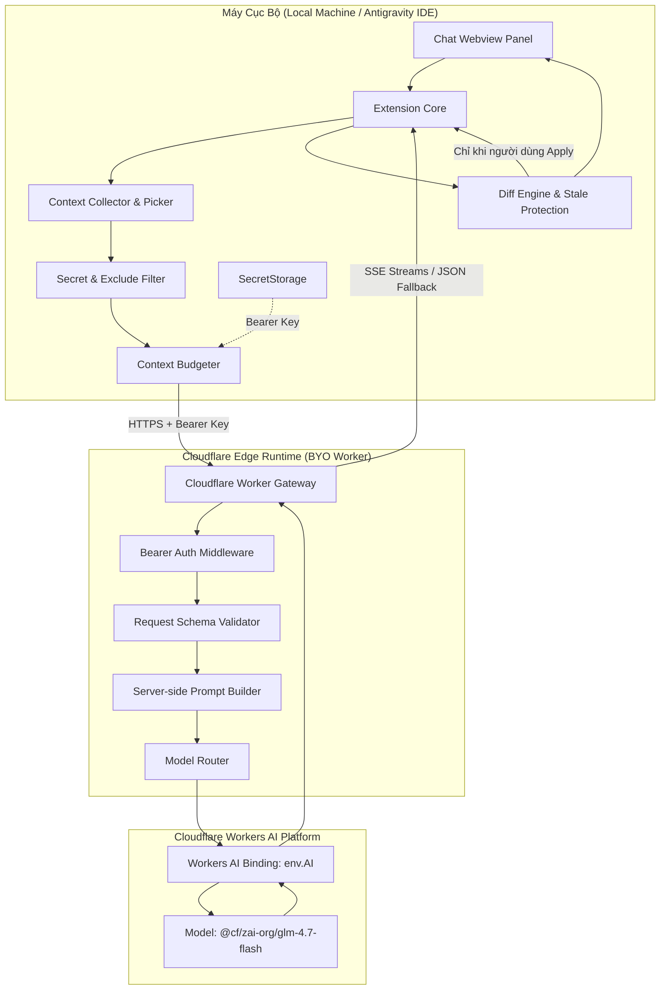

# Bối Cảnh Kiến Trúc Hệ Thống (Architecture Context)

- **Ngày cập nhật gần nhất:** 2026-11-11
- **Trạng thái:** Verified (Theo thiết kế logic của `SRS.md`)
- **Nguồn thông tin:** `journal/requirements/SRS.md` Phần 2, Phần 7 và Phần 10

---

## 1. Sơ Đồ Kiến Trúc Mức Cao (High-Level Architecture)

---

## 2. Phân Tách Trách Nhiệm Giữa Các Tầng

### 2.1. Tầng Extension (`src/extension/`)
- Chạy trên Extension Host của Antigravity IDE.
- Đăng ký các câu lệnh: `nescode.openChat`, `nescode.configureConnection`, `nescode.checkConnection`, `nescode.explainSelection`, `nescode.fixSelection`, `nescode.generateTests`.
- Khởi tạo và quản lý Chat Webview Panel với Content Security Policy (CSP) nghiêm ngặt.
- Quản lý API Key an toàn thông qua `context.secrets` (`SecretStorage`).
- Thu thập ngữ cảnh (selection, active file), chạy bộ lọc exclude patterns và cắt giảm dữ liệu theo ngân sách token (`ContextBudgeter`).
- Hiển thị bản xem trước thay đổi (Diff Preview), kiểm tra tính nguyên vẹn của tài liệu (`Stale Document Protection`) và áp dụng thay đổi (`WorkspaceEdit`) chỉ khi người dùng bấm Apply.

### 2.2. Tầng Worker Backend (`src/worker/`)
- Chạy trên Cloudflare Workers (V8 Edge Isolates).
- Điểm vào duy nhất kết nối với mô hình AI thông qua binding `env.AI`.
- Middleware xác thực Bearer API Key sử dụng phương thức so sánh an toàn thời gian (`timingSafeEqual`).
- Xác thực schema request, loại bỏ role không hợp lệ, chặn đường dẫn bất thường.
- Xây dựng System Prompt an toàn ở phía máy chủ (Server-side Policy), ngăn chặn Prompt Injection từ mã nguồn không đáng tin cậy.
- Định tuyến model trong danh sách cho phép (Model Allowlist) và chuẩn hóa luồng Server-Sent Events (SSE) hoặc JSON fallback.
- Chuẩn hóa mã lỗi hệ thống (`AI_QUOTA_EXCEEDED`, `AI_CAPACITY_UNAVAILABLE`, `INVALID_REQUEST`).

### 2.3. Tầng Dùng Chung (`src/shared/`)
- Chứa các định nghĩa TypeScript thuần túy (pure types, interfaces, error codes, constants).
- Đảm bảo tính nhất quán của API contract giữa client và server mà không mang theo bất kỳ phụ thuộc runtime nào của Node.js, VS Code hay Cloudflare.

---

## 3. Các Nguyên Tắc Kiến Trúc Bất Biến (Architectural Invariants)
1. **Không có Cloudflare Account Token ở Client:** Extension không bao giờ biết Account ID hay Account Global Key của người dùng.
2. **Không lưu mã nguồn trên Backend:** Worker không có database, không ghi log payload request/response.
3. **Người dùng luôn có quyền kiểm soát cuối cùng (Human-in-the-Loop):** Không có thao tác ghi đè mã nguồn hay chạy lệnh shell nào được diễn ra tự động mà thiếu sự bấm nút chấp thuận từ người dùng.
